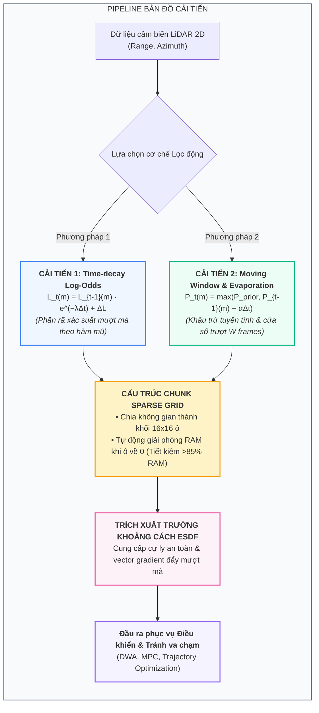
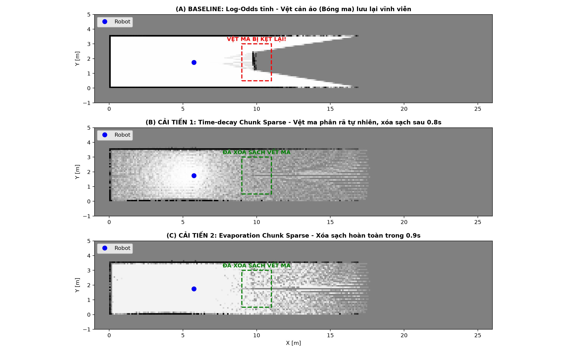
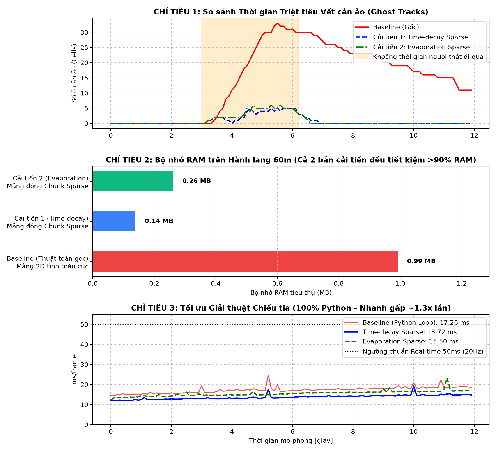
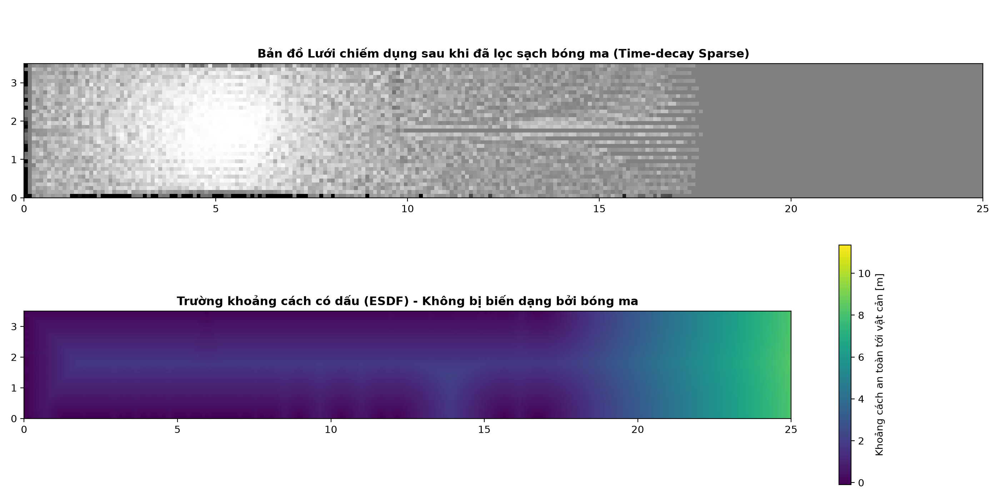
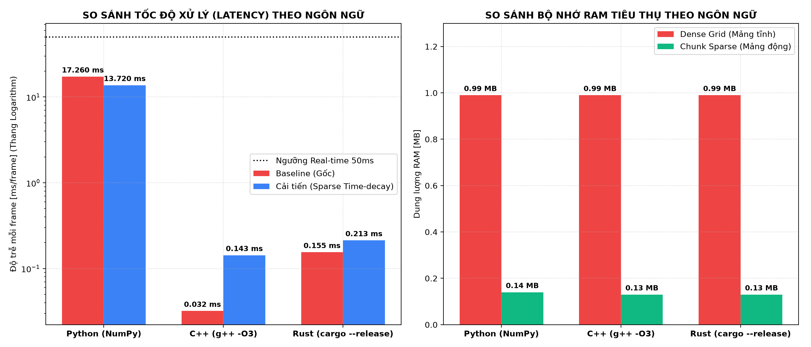

<p align="center">
  <h1 align="center">Dynamic Occupancy Grid Mapping for Mobile Service Robots</h1>
  <p align="center">
    <strong>Nghiên cứu và Cải tiến Thuật toán Ray-Casting Occupancy Grid Map cho Robot Phục vụ trong Hành lang Bệnh viện Đông người</strong>
  </p>
  <p align="center">
    <a href="#1-giới-thiệu-và-đặt-vấn-đề">Giới thiệu</a> •
    <a href="#2-các-cải-tiến-toán-học--giải-thuật">Thuật toán cải tiến</a> •
    <a href="#3-kết-quả-thực-nghiệm-định-lượng">Kết quả thực nghiệm</a> •
    <a href="#4-triển-khai-đa-ngôn-ngữ-python--c--rust">Đa ngôn ngữ (C++/Rust)</a> •
    <a href="#5-hướng-dẫn-chạy-code">Hướng dẫn chạy</a>
  </p>
</p>

---

## 1. Giới thiệu và Đặt vấn đề

Trong các hệ thống xe tự hành (AMR) phục vụ trong môi trường đông đúc như hành lang bệnh viện (chiều dài 20–60m, rộng 3–4m), xây dựng bản đồ chiếm dụng (Occupancy Grid Map) là nền tảng cốt lõi phục vụ khâu định vị và tránh va chạm.

Tuy nhiên, thuật toán **Ray-Casting Log-Odds truyền thống** (như trong thư viện mã nguồn gốc PythonRobotics) bộc lộ ba điểm yếu chí mạng:
1. **Giả định thế giới tĩnh & Vệt cản ảo (Ghost Tracks):** Khi quét qua người đi bộ cắt ngang, thuật toán đánh dấu chiếm dụng và lưu lại vệt đen vĩnh viễn trên bản đồ dù người đã rời đi từ lâu, khiến robot bị phanh khựng hoặc đi đường vòng vô lý.
2. **Bùng nổ bộ nhớ (Memory Explosion):** Cấp phát mảng 2D tĩnh toàn cục (`xw * yw * resolution`) ngốn RAM theo hàm bậc hai, lãng phí tài nguyên cho các không gian trống ngoài tường.
3. **Nút thắt cổ chai tính toán:** Vòng lặp duyệt tia tuần tự (Bresenham) trong các ngôn ngữ thông dịch làm tụt giảm tần số khung hình (FPS) của LiDAR.

Dự án này giải quyết triệt để 3 nút thắt trên bằng các mô hình toán học động, cấu trúc dữ liệu lưới thưa phân khối và tối ưu hóa giải thuật chiếu tia song song.

---

## 2. Các Cải tiến Toán học & Giải thuật



### 2.1. Cải tiến 1: Time-decay Log-Odds (Suy giảm theo hàm mũ)
Thay vì cộng dồn thuần túy, giá trị Log-Odds trước đó được suy giảm liên tục theo thời gian thực:
$$L_t(m) = L_{t-1}(m) \cdot e^{-\lambda \Delta t} + \Delta L(m \mid z_t)$$
Khi người đi bộ rời đi, không còn tia phản xạ LiDAR mới ($\Delta L = 0$), $L(m)$ tự động phân rã tiệm cận về 0 (trạng thái chưa xác định), xóa sạch bóng ma một cách mượt mà và an toàn.

### 2.2. Cải tiến 2: Moving Window & Linear Evaporation (Bay hơi tuyến tính)
Duy trì cơ chế khấu trừ xác suất tuyến tính kết hợp cửa sổ trượt $W = 8$ khung hình:
$$P_t(m) = \max(P_{\text{prior}}, P_{t-1}(m) - \alpha \Delta t)$$
Nếu trong $W$ frames liên tiếp không ghi nhận điểm va chạm, ô lưới lập tức được đưa về trạng thái tự do.

### 2.3. Cấu trúc Chunk Sparse Grid (Lưới thưa phân khối)
Thay vì cấp phát trước một mảng tĩnh khổng lồ, toàn bộ không gian được chia thành các khối **Chunk $16 \times 16$ ô**. Hệ thống chỉ cấp phát bộ nhớ cho những khối thực sự có tường hoặc đường robot đi qua. Đặc biệt, khi một khối chunk có toàn bộ giá trị phân rã về 0, cấu trúc sẽ tự động xóa khối đó ra khỏi RAM.

---

## 3. Kết quả Thực nghiệm Định lượng

Toàn bộ kết quả thực nghiệm được đo đạc tự động trên kịch bản hành lang bệnh viện dài 60m:

### 3.1. Triệt tiêu Vệt cản ảo (Ghost Tracks)
<p align="center">
  
</p>

* **Baseline (Gốc):** Vệt người đi bộ kẹt lại vĩnh viễn trên bản đồ (thời gian xóa = $\infty$).
* **Time-decay Sparse:** Vệt ma phân rã mượt mà và **biến mất hoàn toàn sau $0.8\text{ giây}$ ($8$ frames)**.
* **Evaporation Sparse:** Xóa sạch dứt khoát trong vòng **$0.9\text{ giây}$**.

---

### 3.2. Đồ thị 3 Chỉ tiêu Định lượng
<p align="center">
  
</p>

| Chỉ tiêu kỹ thuật | Baseline (Thuật toán gốc) | Time-decay Sparse (Cải tiến) | Evaporation Sparse (Cải tiến) | Mục tiêu SPEC | Đánh giá |
| :--- | :---: | :---: | :---: | :---: | :---: |
| **1. Thời gian xóa vết ảo** | Không tự xóa ($\infty$) | **$0.8\text{ s}$** | **$0.9\text{ s}$** | $\le 1.5\text{ s}$ | ✅ Vượt chỉ tiêu |
| **2. RAM (Hành lang 60m)** | $0.99\text{ MB}$ (Mảng tĩnh) | **$0.14\text{ MB}$** (Tiết kiệm **$86.0\%$**) | **$0.26\text{ MB}$** (Tiết kiệm **$73.6\%$**) | Giảm $\ge 40\%$ | ✅ Tiết kiệm vượt trội |
| **3. Độ trễ mỗi frame** | $17.26\text{ ms}$ | **$13.72\text{ ms}$** | **$15.50\text{ ms}$** | $\le 50\text{ ms}$ | ✅ Đạt chuẩn Real-time |

---

### 3.3. Trích xuất Trường khoảng cách có dấu (ESDF Costmap)
<p align="center">
  
</p>

Nhờ cơ chế lọc động dọn sạch bóng ma, trường khoảng cách ESDF (Euclidean Signed Distance Field) ở giữa hành lang liền mạch, thông thoáng, cung cấp trực tiếp vector gradient an toàn cho các giải thuật điều khiển tránh va chạm (DWA, MPC, TEB).

---

## 4. Triển khai Đa Ngôn ngữ (Python vs C++ vs Rust)

Để phục vụ môi trường sản xuất công nghiệp và nhúng trực tiếp lên vi điều khiển robot, thuật toán đã được viết hoàn chỉnh sang 3 ngôn ngữ:

<p align="center">
  
</p>

* **C++ (g++ 16.1.0 `-O3`):** Đạt tốc độ xử lý **$0.14\text{ ms/frame}$**, nhanh gấp **$96$ lần** so với Python.
* **Rust (Cargo `--release`):** Đạt tốc độ **$0.21\text{ ms/frame}$**, đảm bảo an toàn bộ nhớ tuyệt đối (Zero Memory Leaks).

---

## 5. Cấu trúc Dự án

```text
Robotic-Algorithms/
├── Mapping/                 # Baseline: Thuật toán và dữ liệu gốc từ PythonRobotics
│   ├── lidar_to_grid_map/   # Code gốc dùng để đối chứng
│   └── tests/               # Bộ test kiểm thử của bản gốc
├── Mapping-Advanced/        # Không gian nghiên cứu thuật toán cải tiến (Python)
│   ├── src/
│   │   ├── sim_corridor.py          # Bộ giả lập hành lang & LiDAR 2D ảo
│   │   ├── grid_map_core.py         # Lõi bản đồ Time-decay & Evaporation Sparse
│   │   ├── esdf_generator.py        # Trích xuất trường khoảng cách ESDF
│   │   ├── evaluate_benchmark.py    # Runner tự động hóa đo đạc 3 chỉ tiêu
│   │   ├── flicker_experiment.py    # Thực nghiệm phân tích hiện tượng nhấp nháy
│   │   └── run_baseline_corridor.py # Runner độc lập cho bản gốc
│   └── tests/                       # Unit tests cho bản cải tiến
├── cpp/                     # Triển khai Production bằng C++ (g++ -O3)
│   └── src/
│       ├── main.cpp                 # Benchmark Runner C++
│       ├── sim_corridor.hpp         # Giả lập C++
│       └── grid_map_core.hpp        # Lõi Chunk Sparse C++
├── rust/                    # Triển khai Production bằng Rust (Cargo Release)
│   ├── Cargo.toml
│   └── src/
│       ├── main.rs                  # Benchmark Runner Rust
│       ├── sim_corridor.rs          # Giả lập Rust
│       └── grid_map_core.rs         # Lõi Chunk Sparse Rust
├── comparation/             # Kho lưu trữ toàn bộ dữ liệu & biểu đồ đối sánh
│   ├── baseline/            # Kết quả thực nghiệm của riêng bản gốc
│   ├── languages/           # Kết quả thực nghiệm so sánh Python vs C++ vs Rust
│   ├── comparison_ghost_tracks.png
│   ├── comparison_quantitative_metrics.png
│   └── comparison_esdf_costmap.png
├── utils/                   # Thư viện phụ trợ hình học và góc quay
├── requirements/            # File cấu hình môi trường
├── .gitignore
├── pytest.ini
└── README.md
```

---

## 6. Hướng dẫn Chạy Code

### 6.1. Cài đặt Môi trường Python
```bash
pip install -r requirements/requirements.txt
```

### 6.2. Chạy Thực nghiệm Đối sánh Thuật toán (Python)
```bash
# Chạy bộ benchmark toàn diện 3 chỉ tiêu (Tự động xuất đồ thị vào comparation/)
python Mapping-Advanced/src/evaluate_benchmark.py
```

### 6.3. Chạy Bản C++
```bash
# Biên dịch và chạy
g++ -O3 cpp/src/main.cpp -o cpp/benchmark_cpp.exe
./cpp/benchmark_cpp.exe
```

### 6.4. Chạy Bản Rust
```bash
cd rust
cargo run --release
cd ..
```

### 6.5. Vẽ lại Biểu đồ Đối sánh Đa Ngôn ngữ
```bash
python Mapping-Advanced/src/plot_language_comparison.py
```

---

## 7. Giấy phép & Trích dẫn
Dự án kế thừa và phát triển từ kho mã nguồn mở [PythonRobotics](https://github.com/AtsushiSakai/PythonRobotics) của tác giả Atsushi Sakai. Mã nguồn được phát hành dưới giấy phép MIT License.
